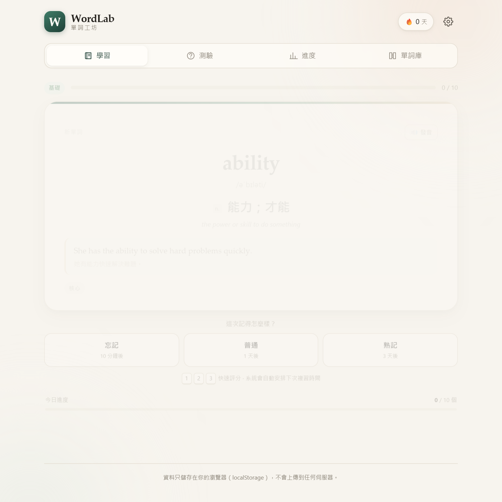
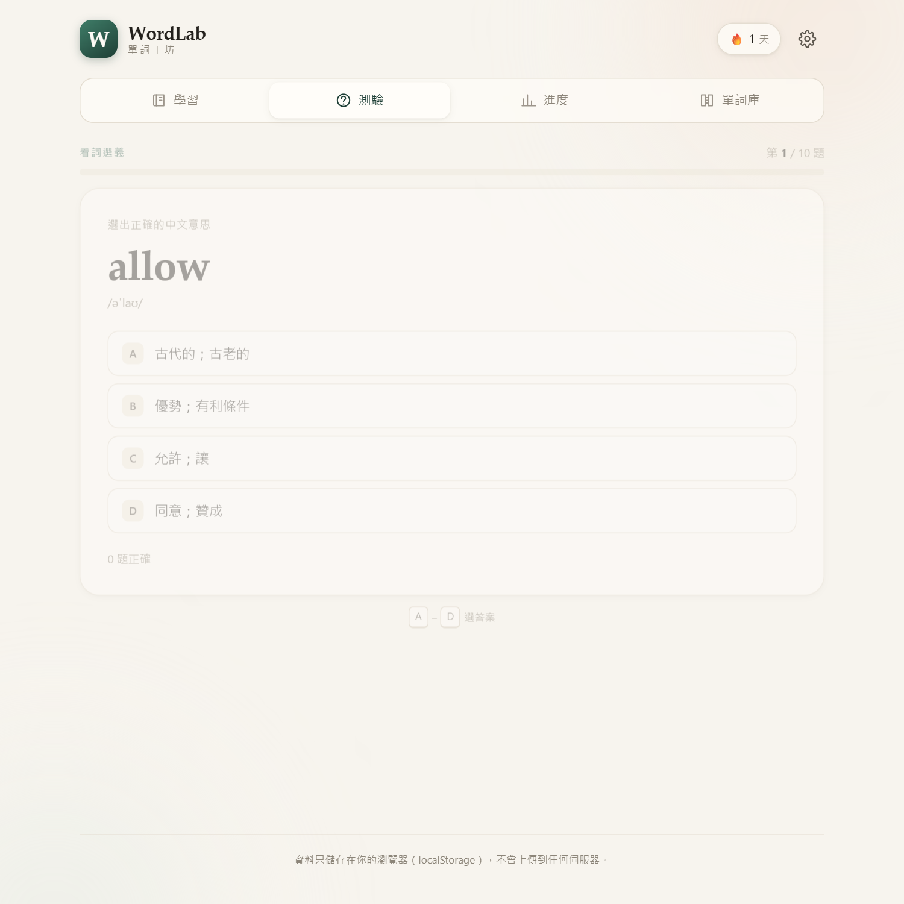
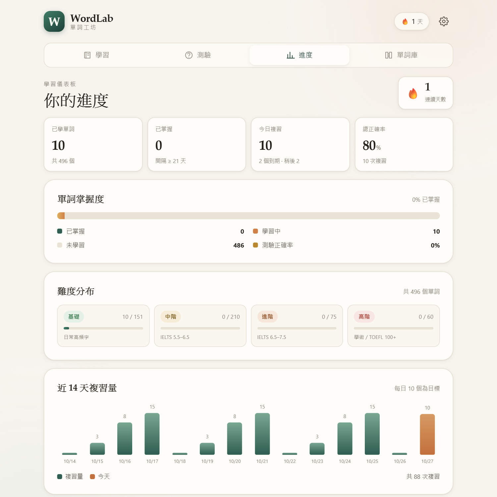

# WordLab 單詞工坊

用間隔重複法（spaced repetition）學習英文單詞的離線網頁 App。
會自動記錄學習進度、依記憶曲線安排複習，並出題考你。

**496 個單詞 · 四個難度 · 純前端 · 不需帳號**

[](https://github.com/ssbbmmlui/testing456/actions/workflows/deploy.yml)

---

## 線上使用

部署完成後可直接開啟：

**https://ssbbmmlui.github.io/testing456/**

也可以在本地使用：雙擊 `index.html`，或用任何靜態伺服器（例如 `python -m http.server`）開啟。

---

## 功能

### 學習（間隔重複 SRS）

- **翻卡學習**：先看英文、自己回想，再翻面看音標、詞性、中文釋義、英文定義與例句
- **三種評分**：忘記 / 普通 / 熟記，系統自動安排下次複習時間
  - 忘記 → 10 分鐘後再練（同日內重複）
  - 普通 → 1 天 → 3 天 → 依難度係數遞增
  - 熟記 → 3 天 → 5 天 → 更長的間隔
- **智慧佇列**：到期複習優先，再用新詞補足每日目標
- **每日目標** 10 / 20 / 30 / 50 個，可隨時調整
- **只複習到期的**：一鍵切換成純複習模式
- **鍵盤操作**：`Space` 翻面、`1` 忘記、`2` 普通、`3` 熟記

### 測驗（自動出題）

| 模式 | 玩法 |
|---|---|
| 混合模式 | 四種題型隨機出現 |
| 看詞選義 | 看英文單詞，選出正確中文意思 |
| 看義選詞 | 看中文意思，選出正確英文單詞 |
| 拼寫練習 | 看中文意思，打出英文單詞（含提示與拼字比對） |
| 聽力測驗 | 聽發音，選出正確意思 |

- 可選 10 / 20 / 30 題，答題後立即顯示答案、音標、例句
- **答錯的單詞會自動排回複習佇列**（10 分鐘後）
- 選擇題的干擾項會自動避開意思相近的中文

### 進度記錄

- 連續學習天數（🔥 打卡）
- 已學單詞、已掌握（間隔 ≥ 21 天）、今日複習量、總正確率
- 單詞掌握度與**四級難度分布**
- 近 14 天複習量柱狀圖、近 12 週學習熱力圖
- 最近測驗紀錄

### 單詞庫與設定

- 496 個單詞可搜尋（英文／中文），依難度與狀態篩選
- 單詞詳情：音標、釋義、例句、下次複習時間、複習次數、目前間隔、記憶強度
- 新單詞難度可設定（全部／基礎／中階／進階／高階）
- 發音口音（美式／英式）、自動發音
- **匯出／匯入進度 JSON**、重設進度

---

## 截圖

| 學習卡片 | 測驗 | 進度 |
|---|---|---|
|  |  |  |

更多截圖在 [`docs/screenshots/`](docs/screenshots)。

---

## 難度分級

| 等級 | 名稱 | 單詞數 | 程度參考 |
|---|---|---|---|
| 1 | 基礎 | 151 | 日常高頻字 |
| 2 | 中階 | 210 | IELTS 5.5–6.5 |
| 3 | 進階 | 75 | IELTS 6.5–7.5 / TOEFL 80–100 |
| 4 | 高階 | 60 | 學術寫作 / TOEFL 100+ |

預設由「基礎」開始；可在設定或首次開啟時指定只學某一級。
已學過的單詞複習不受難度設定影響。

---

## 技術

- 純 HTML / CSS / JavaScript（無框架、無建置工具、無外部依賴）
- 資料存於瀏覽器 `localStorage`（key：`wordlab.v1`），不會上傳到任何伺服器
- 語音使用瀏覽器內建 Web Speech API（Chrome / Edge / Safari 支援最佳）

```
.
├─ index.html              應用外框
├─ favicon.svg
├─ site.webmanifest
├─ css/style.css           全部樣式（含手機版）
├─ js/app.js               狀態、SRS 排程、學習、測驗、統計
├─ data/
│  ├─ words.js             基礎 + 中階（361）
│  ├─ words-extra.js       進階 + 高階（120）
│  └─ words-extra2.js      名詞補充（15）
├─ scripts/build.mjs       驗證資料 + 輸出 _site
├─ scripts/smoke-test.mjs  無頭瀏覽器端到端檢查
├─ docs/screenshots/       截圖
└─ .github/workflows/deploy.yml   push 到 main 自動部署 GitHub Pages
```

### 本機開發

```bash
# 驗證資料並建置
node scripts/build.mjs

# 啟用本機伺服器
python -m http.server 8000
# é–‹å•Ÿ http://localhost:8000
```

### 新增單詞

在 `data/words.js`（或 `data/words-extra.js`）的陣列加入一筆：

```js
{
  id: 'ability',                    // 唯一識別碼（進度記錄用，不可重複）
  word: 'ability',
  phonetic: '/əˈbɪləti/',
  pos: 'n.',
  zh: '能力；才能',
  def: 'the power or skill to do something',
  example: 'She has the ability to solve hard problems quickly.',
  exampleZh: '她有能力快速解決難題。',
  level: 1,                         // 1=基礎 2=中階 3=進階 4=高階
  tags: ['核心']
}
```

`scripts/build.mjs` 會檢查必填欄位、重複、音標格式與難度範圍。

---

## 自動部署

本專案使用 **GitHub Actions + GitHub Pages**：

- 每次 push（合併 PR）到 `main` → 自動驗證單詞資料 → 建置 `_site/` → 部署到 GitHub Pages
- 也可以在 **Actions → Deploy WordLab to GitHub Pages → Run workflow** 手動觸發
- Pages 站台設定（只需一次）：**Settings → Pages → Build and deployment → Source: GitHub Actions**

---

## 授權

MIT License，詳見 [LICENSE](LICENSE)。

